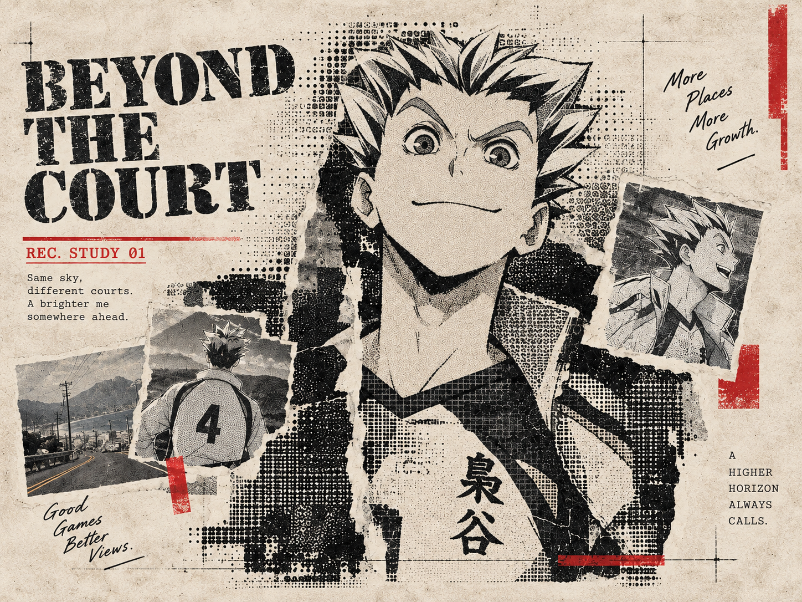
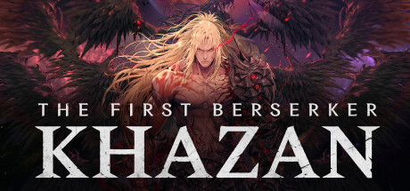
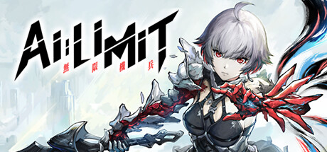
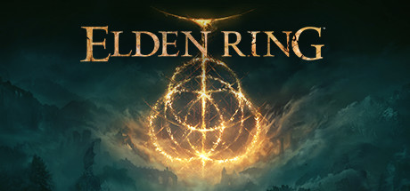
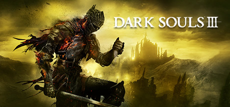

# Hi, I'm Euan Zhu (yunfeizhu) 👋

- 👨‍💻 I'm an **AI full-stack developer** with a focus on **frontend development**.
- 🛠️ I work with **Vue and React** on the frontend, and **Node.js and Python** across the stack.
- 🤖 I'm interested in building **AI applications** and **developer tools**.
- 🌱 I contribute to **open source** through bug fixes, regression tests, and localization.
- 🔍 I enjoy **tracking down bugs** and understanding how things work.
- 🎮 My favorite game genres are **Soulslikes and JRPGs**.
- 🏐 I'm a fan of **sports anime** with plenty of **passion and team spirit**.
- 🎨 I enjoy experimenting with **AI-generated content (AIGC)**.

**Languages and Tools:**

 &nbsp;  &nbsp;  &nbsp;  &nbsp;  &nbsp;  &nbsp;  &nbsp;  &nbsp; 

## Gaming 🎮

<table>
<tr>
<td width="230" align="center" valign="top">
   
  <strong>The First Berserker: Khazan</strong> 
  🟢 Now playing
</td>
<td width="230" align="center" valign="top">
   
  <strong>Forza Horizon 6</strong> 
  Previously played
</td>
<td width="230" align="center" valign="top">
   
  <strong>WUCHANG: Fallen Feathers</strong> 
  Previously played
</td>
<td width="230" align="center" valign="top">
   
  <strong>AI LIMIT</strong> 
  Previously played
</td>
</tr>
</table>

<table>
<tr>
<td width="230" align="center" valign="top">
   
  <strong>Black Myth: Wukong</strong> 
  Previously played
</td>
<td width="230" align="center" valign="top">
   
  <strong>Lies of P</strong> 
  Previously played
</td>
<td width="230" align="center" valign="top">
   
  <strong>Elden Ring</strong> 
  Previously played
</td>
<td width="230" align="center" valign="top">
   
  <strong>Dark Souls III</strong> 
  Previously played
</td>
</tr>
</table>

## Statistics 📊

  
  &nbsp;
  

## Open Source Contributions 🤝

<!-- CONTRIBUTIONS:START -->

39 merged PRs across 10 external open-source projects. Showing up to 6 recent PRs per project.

| Project | Contributions | Merged PRs |
| --- | --- | --- |
| **[ant-design](https://github.com/ant-design/ant-design)** | Table selection behavior, Transfer state and callbacks. | [#59580](https://github.com/ant-design/ant-design/pull/59580)&nbsp;·&nbsp;[#59570](https://github.com/ant-design/ant-design/pull/59570)&nbsp;·&nbsp;[#59428](https://github.com/ant-design/ant-design/pull/59428) [#59307](https://github.com/ant-design/ant-design/pull/59307) |
| **[ooxml](https://github.com/ChristopherVR/ooxml)** | Spreadsheet formulas, filters, data integrity and slide links. | [#88](https://github.com/ChristopherVR/ooxml/pull/88)&nbsp;·&nbsp;[#86](https://github.com/ChristopherVR/ooxml/pull/86)&nbsp;·&nbsp;[#55](https://github.com/ChristopherVR/ooxml/pull/55) [#53](https://github.com/ChristopherVR/ooxml/pull/53)&nbsp;·&nbsp;[#49](https://github.com/ChristopherVR/ooxml/pull/49)&nbsp;·&nbsp;[#51](https://github.com/ChristopherVR/ooxml/pull/51) [View&nbsp;all&nbsp;10&nbsp;→](https://github.com/ChristopherVR/ooxml/pulls?q=is%3Apr+is%3Amerged+author%3Ayunfeizhu) |
| **[pptx-viewer](https://github.com/ChristopherVR/pptx-viewer)** | Cross-framework UI, localization, recovery and atomic editing. | [#359](https://github.com/ChristopherVR/pptx-viewer/pull/359)&nbsp;·&nbsp;[#354](https://github.com/ChristopherVR/pptx-viewer/pull/354)&nbsp;·&nbsp;[#352](https://github.com/ChristopherVR/pptx-viewer/pull/352) [#351](https://github.com/ChristopherVR/pptx-viewer/pull/351)&nbsp;·&nbsp;[#350](https://github.com/ChristopherVR/pptx-viewer/pull/350)&nbsp;·&nbsp;[#339](https://github.com/ChristopherVR/pptx-viewer/pull/339) [View&nbsp;all&nbsp;16&nbsp;→](https://github.com/ChristopherVR/pptx-viewer/pulls?q=is%3Apr+is%3Amerged+author%3Ayunfeizhu) |
| **[tdesign-vue-next](https://github.com/Tencent/tdesign-vue-next)** | Upload file-list consistency during automatic uploads. | [#6969](https://github.com/Tencent/tdesign-vue-next/pull/6969) |
| **[antdv-next](https://github.com/antdv-next/antdv-next)** | Checkbox registration and cross-page Table selection. | [#894](https://github.com/antdv-next/antdv-next/pull/894)&nbsp;·&nbsp;[#881](https://github.com/antdv-next/antdv-next/pull/881) |
| **[hol-guard](https://github.com/hashgraph-online/hol-guard)** | Mail extension integration and deletion safeguards. | [#3805](https://github.com/hashgraph-online/hol-guard/pull/3805)&nbsp;·&nbsp;[#3278](https://github.com/hashgraph-online/hol-guard/pull/3278) |
| **[FastMCP](https://github.com/punkpeye/fastmcp)** | Additional properties in tool output schemas. | [#373](https://github.com/punkpeye/fastmcp/pull/373) |
| **[MCPHub](https://github.com/samanhappy/mcphub)** | Server lifetime while tools are running. | [#1164](https://github.com/samanhappy/mcphub/pull/1164) |
| **[virtua](https://github.com/inokawa/virtua)** | Viewport measurement for fixed-position containers. | [#965](https://github.com/inokawa/virtua/pull/965) |
| **[awesome-dsh-plugin](https://github.com/awesome-dsh-plugin/awesome-dsh-plugin)** | PPTX editor listing in the plugin directory. | [#5370](https://github.com/awesome-dsh-plugin/awesome-dsh-plugin/pull/5370) |

<!-- CONTRIBUTIONS:END -->

[View all merged PRs to external projects →](https://github.com/search?q=is%3Apr+is%3Amerged+author%3Ayunfeizhu+is%3Apublic+-user%3Ayunfeizhu&type=pullrequests)
